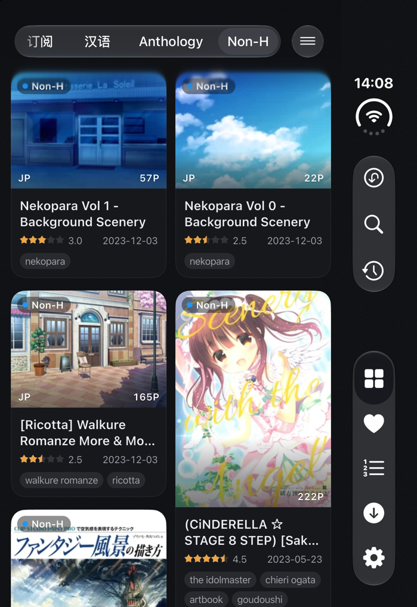
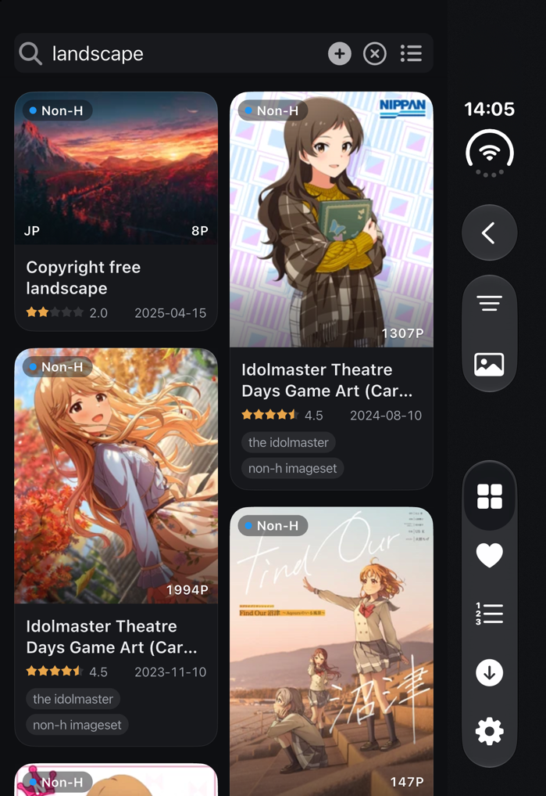
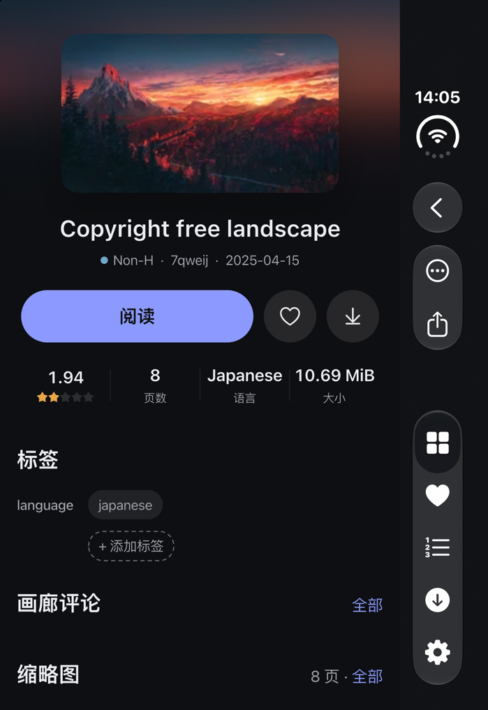
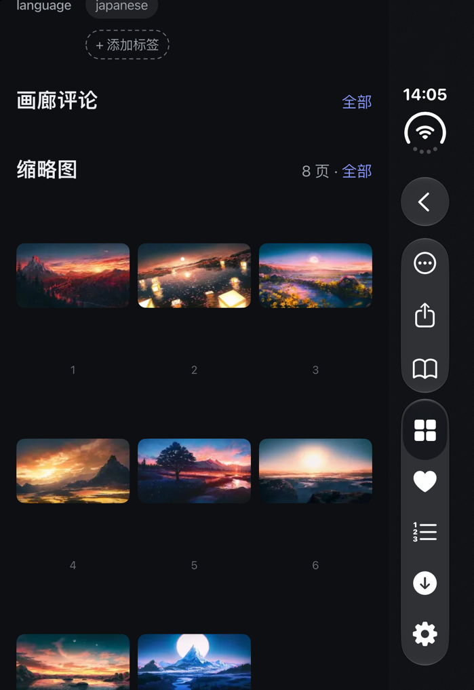
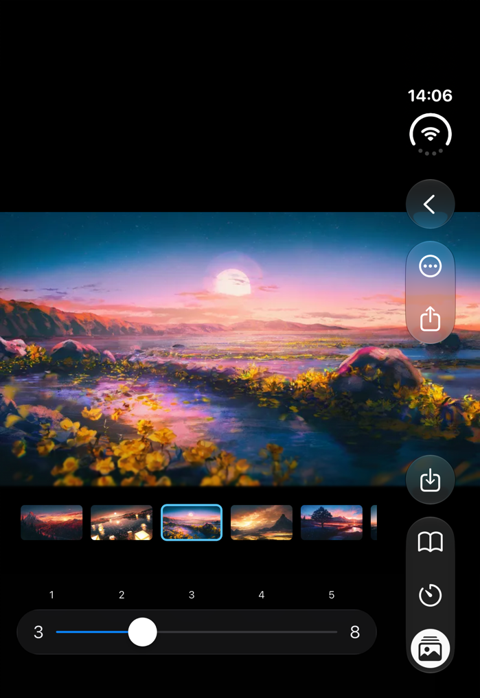
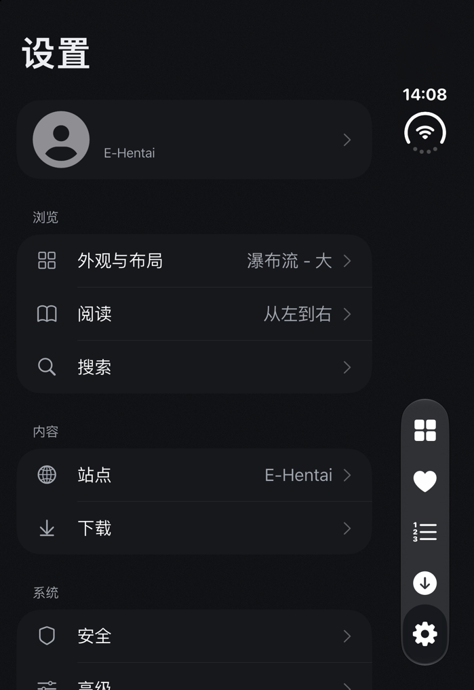
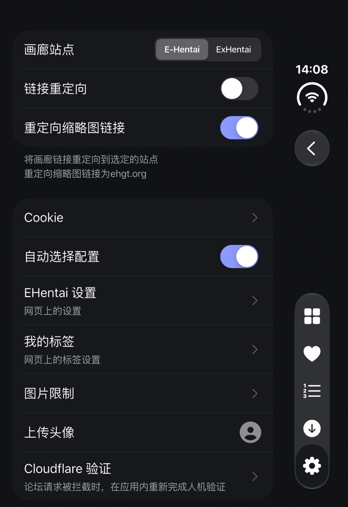
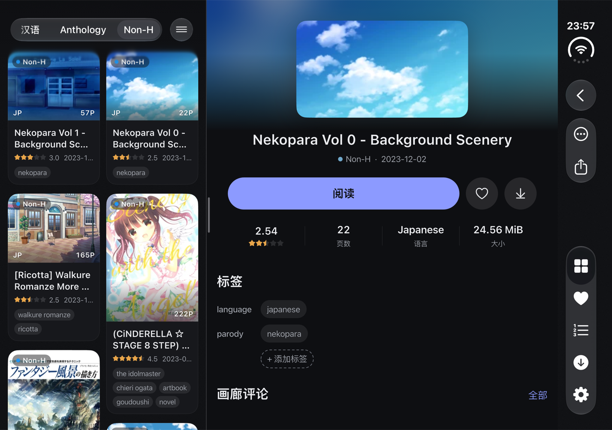
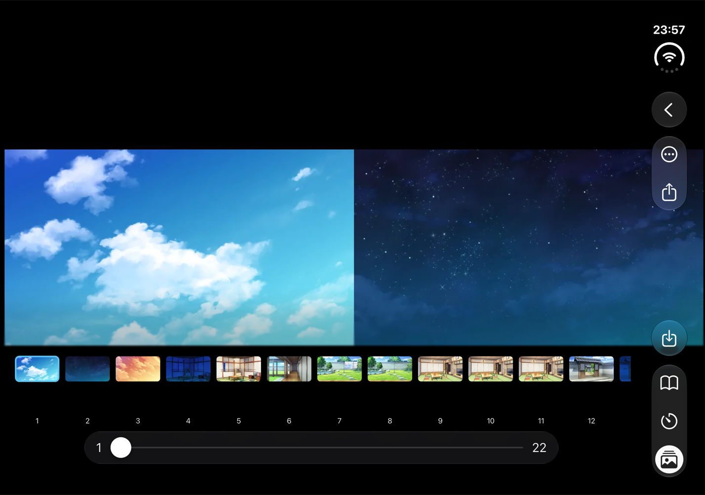
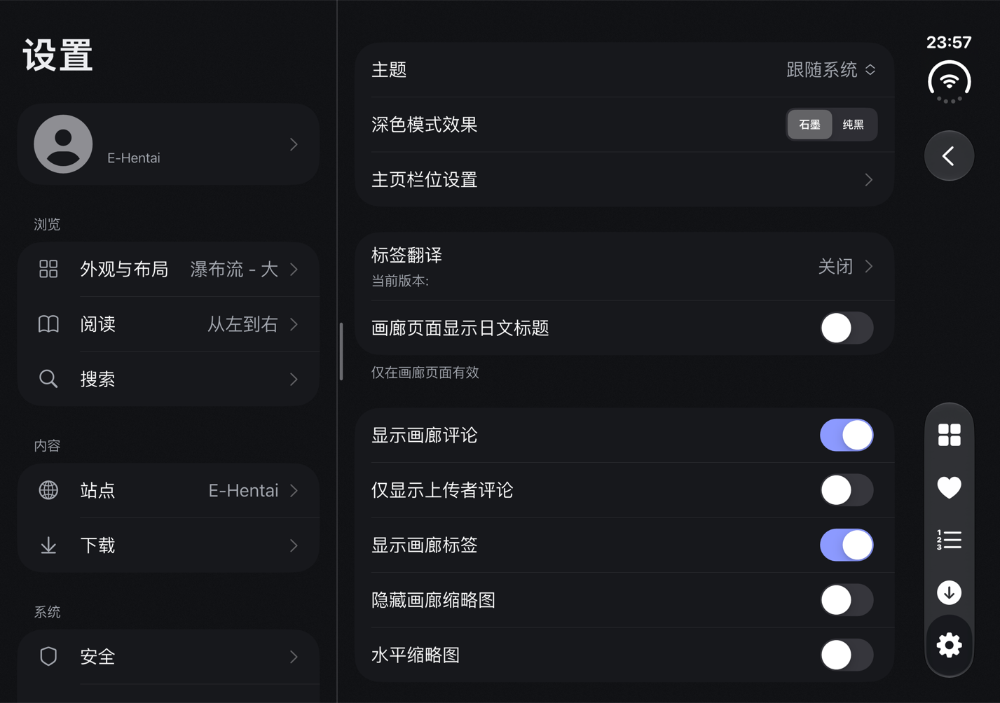

# Eros-FE
English | [简体中文](./README_cn.md)

An unofficial E-Hentai app built with Flutter. This repository is a personal fork of
[erosTeam/eros_fe](https://github.com/erosTeam/eros_fe). The `custom` branch redesigns the main
screens with Liquid Glass navigation and fixes downloads, favorites, sharing, history, avatars,
haptics and Cloudflare verification. It started on iOS/iPadOS and iPhone Duo; **the new UI now also
supports Android and desktop (macOS)**. A Windows build is in progress and will follow in a few days.

The current version is `1.10.1+568`. The iOS Bundle ID is `cn.honjow.fehv`.

## Screenshots

Captured on the iOS 27.1 iPhone Duo Simulator with the dark Graphite theme. All galleries shown are
in the Non-H category.

### Closed (outer display)

| Home (large waterfall cards) | Search | Gallery detail |
| :---: | :---: | :---: |
|  |  |  |
| **Thumbnails** | **Reader** | **Settings** |
|  |  |  |
| **Site settings and Cloudflare verification** | | |
|  | | |

### Open (inner display)

When opened, the app switches to two panes: the list or settings home on the left, and the gallery
detail or a settings page on the right. The reader shows two pages side by side when there is room.
The native vertical bars sit on the right edge.

| Home with gallery detail (two panes) |
| :---: |
|  |
| **Two-page reader with thumbnail strip** |
|  |
| **Settings (two panes)** |
|  |

## Enhancements over upstream

**Redesigned interface**
- One palette with Light, Graphite and Pure Black backgrounds, increased-contrast variants and an
  optional accent color for switches; the Graphite canvas has a fine grain texture.
- Large waterfall cards: continuous corners, category capsule, rating and date on one row, and up to
  3–4 rows of tags with watched tags first in their My Tags colors.
- Card size: five steps per list style, with the column count computed from the actual column width
  and previewed for portrait and landscape in Settings.
- Gallery detail: blurred cover ambience, equal-area cover, parsed title with circle and artist,
  grouped tags and comments; two columns on wide layouts and on an open iPhone Duo.
- Settings: grouped home page (Browse / Content / System), native pull-down menus and one shared
  sub-page shell.

**iPhone Duo and native navigation**
- Uses iOS 27.1 reserved regions and hinge geometry to choose one or two columns from the space
  available; the gallery detail can split across the fold.
- iOS 27.1+ uses a native shell (native top bar, vertical bar and tab bar); iOS 26–27.0 uses a glass
  fallback bar. Transitions, detail flicker and sub-page top bars were checked page by page.
- The reader improves single/double pages, continuous reading, the thumbnail strip, system bars and
  safe areas.

**Android and desktop**
- The redesigned UI now runs on Android and desktop. Android gets glass and solid (Material 3)
  variants: a search capsule on the home page, a navigation rail on large screens, a bottom action
  bar in the gallery detail, a glass reader and an Android 16 style settings home with predictive
  Back.
- macOS 26+ uses native AppKit Liquid Glass for the bottom bar, settings bars and menus, and the
  title bar matches the content canvas.
- Desktop adds a sidebar, card hover actions, right-click menus and keyboard shortcuts, two-pane
  settings, and a desktop reader (layout switch, thumbnail sidebar, page buttons, wheel paging,
  Ctrl+wheel zoom, F for full screen).
- Glass material can be switched between Liquid Glass and frosted glass, or turned off, on every
  platform.
- Windows: the UI is adapted, but no Windows package has been published yet. It is expected in a
  few days.

**Fixes and features**
- Cloudflare verification: switching between E-Hentai and ExHentai no longer requests the forum.
  When the forum is blocked, the app offers in-app verification, and Settings › Site has a new
  "Cloudflare verification" entry. Errors no longer show a full HTML page.
- Favorites: URL-encoded forms avoid HTTP 403, and saves and removals are confirmed by reading the
  server back.
- Downloads: pause, continue or a restored folder rechecks existing files before missing images are
  queued.
- Saving images: save the current or the original image, reusing the cache first; iOS imports
  through PhotoKit and keeps format, transparency and animation.
- Stability fixes for sharing, history, the visible group index, avatar upload and action labels.
- Haptics: tab switches, native bar buttons, menus and Back now give feedback, and selection ticks
  use a pre-warmed native channel.
- Hidden tab entry: tabs hidden from the tab bar get a matching entry in both the iOS 27.1 native
  shell and the older glass top bar (one hidden tab opens directly; several open a picker).

## Changelog

### 2026-11-11: v1.10.1, show full title

Tag: `v1.10.1` ([release](https://github.com/boitar/eros_fe/releases/tag/v1.10.1)).

- **Show Full Title** (Settings › Appearance and Layout, below the Japanese title switch, off by
  default). Many gallery titles look like `(Event) [Circle (Artist)] Romanized Title | Original Title
  [Language]`, and the romanized part alone is often hard to read. With the switch on:
  - gallery cards (list, small list, grid, waterfall) put the event/circle prefix on its own dimmed
    line, then the main title, then the title after `|` on its own line;
  - the gallery page title shows the full title in two parts instead of only the English part.
  With the switch off, everything looks as before.

### 2026-11-10: v1.10.0-nightly, UI redesign for Android and desktop

Tag: `v1.10.0-nightly` ([release](https://github.com/boitar/eros_fe/releases/tag/v1.10.0-nightly)).

- **The whole UI was reworked to support Android and desktop.** Liquid Glass components now run on
  Android, macOS and Windows; macOS 26+ uses native AppKit glass. See *Android and desktop* above.
- **Desktop:** sidebar navigation, card hover and right-click actions, keyboard shortcuts, two-pane
  settings and a desktop reader.
- **Android:** glass home with a search capsule, large-screen navigation rail, solid Material 3
  variant, glass reader and redesigned settings.
- **Top bar blur** ([#1](https://github.com/boitar/eros_fe/issues/1)): at rest, the first list item
  is no longer covered by the Liquid Glass blur; the soft edge appears only once content scrolls under
  the bar, on iOS, iPadOS and Android. The macOS title bar no longer shows a separate white strip.
- **Packages:** iOS (unsigned IPA), Android (arm64-v8a, armeabi-v7a, x86_64 and universal APKs) and
  macOS (DMG). Windows will follow.

### 2026-11-03: hidden tab entry and language section fixes (builds 94–95)

Tags: `2026-11-02-hidden-tab-entry`, `2026-11-02-language-section-fix`,
`2026-11-03-custom-hidden-tab-language`.

- **Hidden tab entry on the older glass top bar** (reported upstream in
  [erosTeam/eros_fe#24](https://github.com/erosTeam/eros_fe/issues/24#issuecomment-6528333971)).
  Below iOS 27.1 with Liquid Glass on, the entry at the left of the gallery, favorites, toplist and
  download top bars always opened History, whichever tab was hidden in Tab Bar Settings.
  - One hidden tab now shows that tab's icon and opens it directly.
  - Several hidden tabs show ⋯, which opens a picker in the order set in Settings.
  - No hidden tabs means no entry; pages opened from the entry show Back; safe mode shows no entry.
  - The data is shared with the iOS 27.1 native shell.
- **Language section colors.** In dark mode, Settings › Advanced showed a pure-black, square block
  around "Language", and its card was narrower, greyer and less rounded than the other groups. That
  group still used Flutter's own `CupertinoListSection.insetGrouped`; it now uses the shared
  `SliverCupertinoListSection.listInsetGrouped`, and a test keeps Flutter's section out of `lib/`.
- Verification: 870 Flutter tests pass, and the new tests fail when the fix is reverted. On the
  newest installed runtime, iOS 27.1 (24A94425), the iPhone Duo simulator shows the language card
  matching the other groups with a working language menu; the glass top-bar entry passed its full
  matrix on the iPhone 18 Pro Max / iOS 27.0 simulator. The unsigned IPA (build 95) is on this fork's
  [Releases](https://github.com/boitar/eros_fe/releases/latest). Physical-device behavior is still
  unconfirmed.

### 2026-11-01: Cloudflare verification and UI polish (builds 79–93)

Tags: `2026-11-01-cf-verification`, `2026-11-01-custom-ui-refresh`.

- **Cloudflare verification.** The forum (forums.e-hentai.org) is behind Cloudflare. Switching sites
  used to request the forum as a side effect; when blocked, the whole "Just a moment..." HTML page was
  shown as an error.
  - Switching sites now only sets the site, fetches igneous and selects the profile; it no longer
    requests the forum.
  - A blocked forum request is recognized as a Cloudflare block. The app asks whether to verify in
    the built-in browser and retries once after verification.
  - Settings › Site has a new "Cloudflare verification" entry.
  - Network errors report only the body length instead of the full HTML.
  - The built-in verification page no longer stays blank, which also restores verification during
    avatar upload.
- **Large waterfall tags.** Cards show 3 rows of tags (4 on narrow cards) instead of 2. Watched
  tags come first and are never folded into "+N".
- **Haptics.**
  - Tab switches use a crisp glass-like tap.
  - Native bar buttons, vertical bar buttons, opening menus and Back give a light tap.
  - Selection ticks use the app's own native channel.
- **Card size.** "Custom width" became five steps per list style, with the column count computed
  from the actual column width.
- **Native shell polish.**
  - Tapping the current tab again first pops to the root page.
  - In single-column layouts, the primary column stays visible during the detail transition.
  - The detail background uses the same image as the cover, so switching galleries no longer
    flickers.
  - The native bar keeps the page title while a dialog is open.
  - Every pushed page provides its top-bar configuration to the native shell, guarded by a source
    test.
- **Graphite grain.** Fixed the grid seams in the background grain.
- **Verification.**
  - All 841 Flutter tests passed; `flutter analyze lib test` reported 0 errors.
  - On the highest installed runtime, iOS 27.1 (24A94425), the iPhone Duo Simulator confirmed that
    switching sites shows no popup, and that the Cloudflare page loads and reports success.
  - Unsigned IPA build 93 is published on this fork's [Releases](https://github.com/boitar/eros_fe/releases/tag/2026-11-01-custom-readme-refresh).
  - Behavior on a physical device is still pending.

### 2026-10-30: fix black screen on device launch

Tag: `2026-10-29-ui-refresh-blackscreen-fix`.

- The canvas color is applied only to the app's own windows (with a root view controller at normal
  window level). System text and keyboard windows stay transparent, which fixes a fully black screen
  after launch on device.

### 2026-10-29: UI redesign (P1–P5)

Tags: `2026-10-29-ui-refresh-p1-palette` through `2026-10-29-ui-refresh-p5-unification`.

- **P1 palette.** Semantic color tokens (canvas, surface, field, hairline, text1–3 and more) cover
  light, dark, increased contrast and elevated: eight variants in total.
  - Restores the dark mode effect setting (Graphite / Pure Black).
  - The native side syncs window and tab-bar host colors.
- **P2 large waterfall.** Rewrites the card look, cover ratio and decoding, the info area and the
  two-row tags.
  - The column count adapts to the list's actual width.
  - On an open iPhone Duo the list spans the fold.
- **P3 gallery detail.** Rebuilds the first screen: ambience, equal-area cover, title parsing and
  a title sheet.
  - Adds a native "Share + …" menu and redesigns tags, comments and thumbnails.
  - Two columns at ≥ 700pt width or on an open iPhone Duo.
- **P4 settings.** Grouped home page, profile row, native pull-down menus, one grouped list style
  and a shared sub-page shell.
- **P5 unification.**
  - Switches follow the accent color.
  - Adds a glass fallback bar for iOS 26–27.0.
  - Inline notes move to section footers.
  - Adds immersive large cards and canvas grain.

### 2026-10-28: iPhone Duo adaptation and reader update

Tags: `2026-10-28-iphone-duo-adaptive`, `2026-10-28-custom-iphone-duo`.

- Bridges iOS 27.1 reserved regions and hinge geometry, chooses the adaptive layout from available
  space, and keeps a fallback for older systems.
- Each tab keeps its own navigation, gallery and search state. Updates the native top bar, segmented
  category bar, scroll fade and localized strings.
- The reader improves single/double pages, continuous reading, thumbnails, system bars and safe
  areas, and fixes controller lifecycle and image request locks on re-entry.

### 2026-10-26: favorite form compatibility and confirmed saves

Tags: `2026-10-26-favorite-form-fix`, `2026-10-26-custom-favorite-form-fix`.

- Favorites submit URL-encoded forms, avoiding the HTTP 403 triggered by multipart text forms.
  Archive downloads, My Tags, site settings and comments got the same fix.
- A save must be confirmed by reading back the category and note; a removal must confirm the
  gallery is no longer favorited. Each operation sends one POST, with bounded readbacks when the
  outcome is uncertain.
- All 554 Flutter tests passed. Twelve native cases passed on iPhone 18 Pro, iPad Pro 11-inch (M5)
  and iPhone Duo.

### 2026-10-18: save gallery images to Photos

Tags: `2026-10-18-gallery-save-cache`, `2026-10-18-custom-gallery-save-cache`.

- Menus offer "Save current image" and "Save original image". The current image reuses the cache
  first. The original reuses only a file confirmed to be the original.
- iOS imports through PhotoKit with add-only access and keeps format, transparency and animation.
  Permission, download, format and write errors stay distinct.
- All 511 tests passed. PNG, JPEG and GIF files in Photos match their source SHA-256 hashes.

### 2026-10-16: eleven modules integrated into custom

`custom` starts at fixed master `2fe86b737` and merges eleven independently deliverable modules in
order. Each module branch holds one complete commit directly on master:

| Module | Use | Independent branch |
| --- | --- | --- |
| Waterfall stability | Settings › Layout › Waterfall / Waterfall - Large | `codex/custom-waterfall` |
| Downloads | Recheck existing files after pause, continue or folder restore | `codex/custom-downloads` |
| Favorites | Traditional/glass forms, server confirmation, account isolation | `codex/custom-favorites-verified` |
| Sharing | Native iOS/iPadOS links, images, files and exports | `codex/custom-sharing` |
| History | Shared initialization, serialized writes, awaited sync | `codex/custom-history` |
| Visible group index | Stable visible UUID/page mapping and restart restoration | `codex/custom-group-index` |
| Action accessibility | Labels for traditional controls | `codex/custom-accessibility` |
| Haptics | Native bridge, progressive pulls and operation feedback | `codex/custom-haptics` |
| Avatar | Album/Files/URL, verified retry and local preview | `codex/custom-avatar` |
| Grid tags | Aligned cards and two-row horizontal tags | `codex/custom-grid-tags` |
| Liquid Glass | Settings › Style: native navigation, top bars, popups and safe areas | `codex/custom-liquid-glass-verified` |

The integration passed all 486 tests. iPhone 18 Pro and iPad Pro 11-inch (M5) passed 42 native
cases. The current grid tags tag is `2026-10-15-custom-grid-tags-independent-verifier`.

## Build and verify

Use Flutter 3.47.1 (minimum 3.47.0) and Xcode 27. In a new checkout, prepare the local
configuration, then run:

```sh
cp lib/config/config.dart.sample lib/config/config.dart
analysis_before="$(mktemp)"
cp analysis_options.yaml "$analysis_before"
flutter pub get --enforce-lockfile
cp "$analysis_before" analysis_options.yaml
dart analyze --format=machine
flutter test --no-pub
```

Simulator builds use the `Debug-SimulatorUI` configuration, which omits MLKit and the legacy archive
downloader registration. Native verifiers live in `benchmark/*_ui_tests/run-native.sh`. They take
the device UUID, an output directory outside the checkout and a unique run name, for example:

```sh
bash benchmark/favorites_ui_tests/run-native.sh \
  "$DEVICE_UUID" "$OUTPUT_DIRECTORY" favorites
```

For glass combinations, prefix the favorites, avatar, group-index, haptics or downloads runner with
`EROS_VERIFY_GLASS=1`.

**Not yet verified:**
- Physical-device VoiceOver and vibration strength
- OCR and legacy archive downloads
- LiveContainer
- Real-network Cloudflare blocks and forum uploads

Simulator results do not substitute for these checks.

## Installation

Packages of this fork are published on [Releases](https://github.com/boitar/eros_fe/releases/latest).

- **Android:** pick the APK for your device's architecture (`arm64-v8a` for most phones), or the
  universal APK if unsure.
- **macOS:** open the DMG and drag Eros-FE to Applications. The app is ad hoc signed, so the first
  launch may need right-click › Open.
- **Windows:** not published yet; expected in a few days.

### iOS

Unsigned IPAs are arm64, main app unsigned, Bundle ID `cn.honjow.fehv`, iOS 15.6 or later.

1. Download the latest `Eros-FE_*-unsigned_*.ipa` from [Releases](https://github.com/boitar/eros_fe/releases/latest).
2. Sign and install it yourself with a tool such as [AltStore](https://altstore.io). It replaces any
   installed app with the same Bundle ID, so back up the app data before switching.

Upstream builds are on [erosTeam/eros_fe Releases](https://github.com/erosTeam/eros_fe/releases/latest)
and [AltStore.json](https://config-feh.vercel.app/AltStore.json); they do not include these enhancements.

## Features

- [x] Popular, Watched, Home, Favorites
- [x] Custom groups combining multiple conditions, each with its own style
- [x] List, waterfall and grid views
- [x] Light and dark mode
- [x] Gallery information and image viewer, automatic page turning
- [x] E-Hentai / ExHentai switch
- [x] Search, advanced search and image search
- [x] Tag translation and tag suggestions while searching
- [x] Login and biometric lock
- [x] Post, vote on and translate comments; forum avatars and quick replies
- [x] EH settings and My Tags sync; long-press a tag for quick settings
- [x] Downloads, original images, archive downloads and reading downloaded galleries
- [x] WebDAV sync for history, quick search, reading progress and group configuration
- [x] Hide images with QR codes and similar ad images by pHash

## Translations

Pull requests are welcome. App strings are in `lib/l10n/{lang}.arb`.

## Thanks

The UI mainly follows [E-HentaiViewer](https://github.com/kayanouriko/E-HentaiViewer). Code and logic
from these projects were used and referenced:

- [E-HentaiViewer](https://github.com/kayanouriko/E-HentaiViewer)
- [EhViewer](https://github.com/seven332/EhViewer)
- [EhTagTranslation/Database](https://github.com/EhTagTranslation/Database) (tag translations)

Translation contributors:

- [KeepSOBP](https://github.com/KeepSOBP): Korean
- [pursel](https://github.com/pursel), [Gigas002](https://github.com/Gigas002): Russian
- [cristal-node](https://github.com/cristal-node): Japanese

## Dependencies (partial)

- Network: [dio](https://pub.dev/packages/dio)
- State management: [getx](https://pub.dev/packages/get)
- Database: [sqflite](https://pub.dev/packages/sqflite)
- Persistence: [shared_preferences](https://pub.dev/packages/shared_preferences)
- Internationalization: [intl](https://pub.dev/packages/intl)
- Images: [cached_network_image](https://pub.dev/packages/cached_network_image), [extended_image](https://pub.dev/packages/extended_image)
