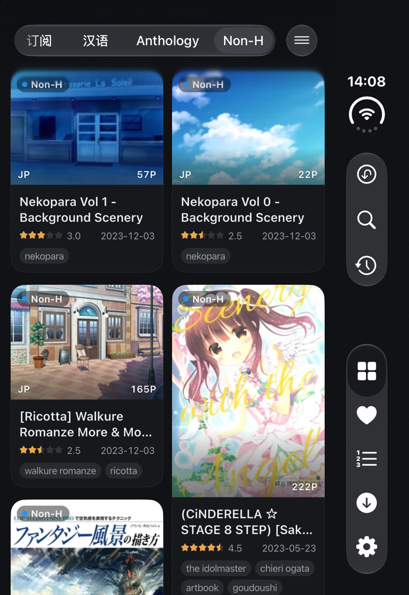
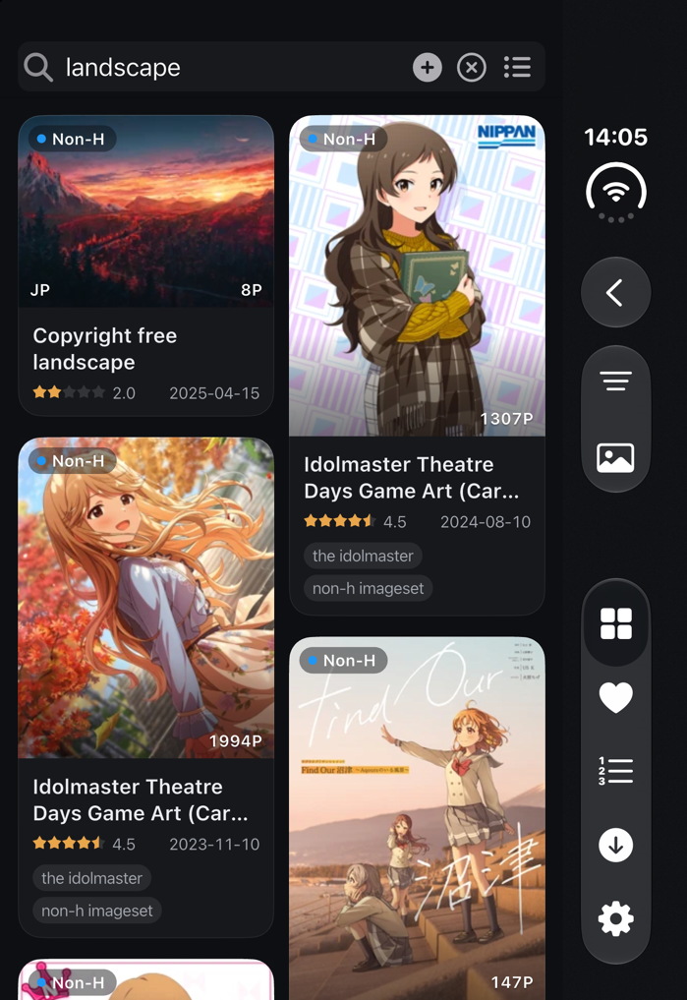
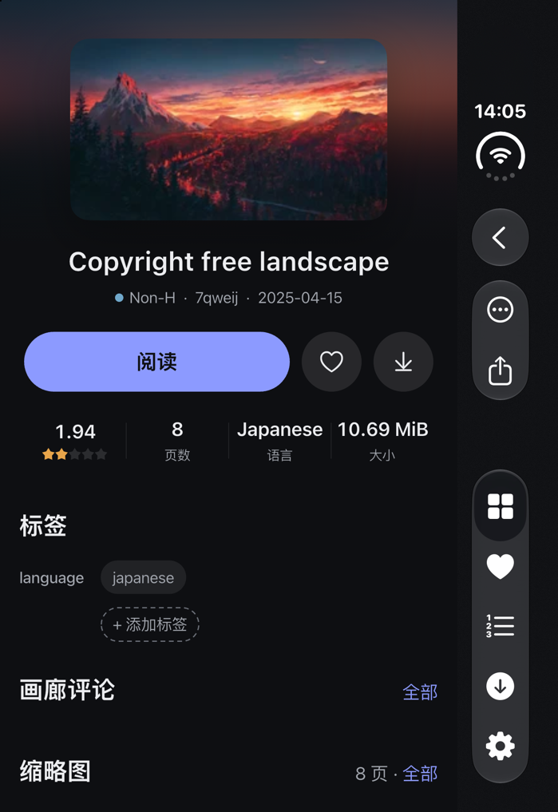
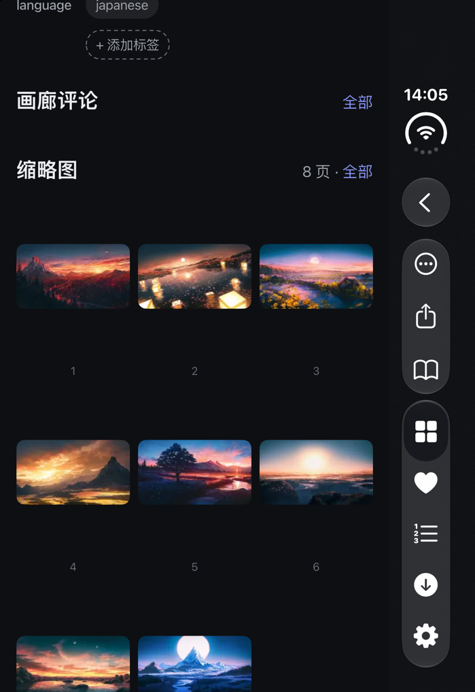
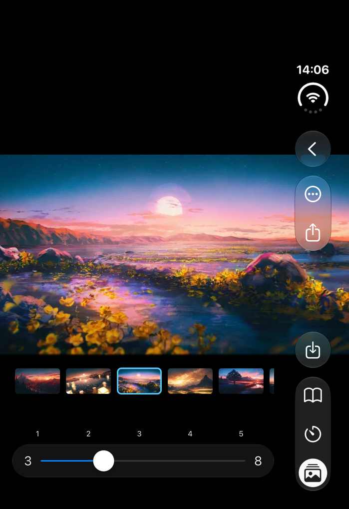
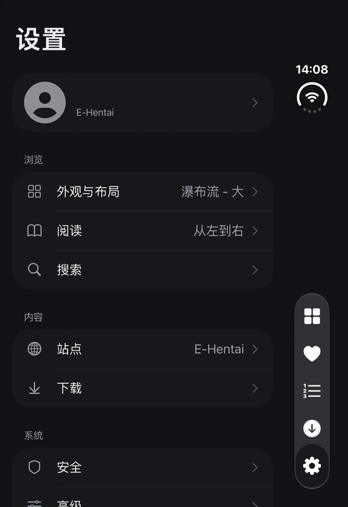
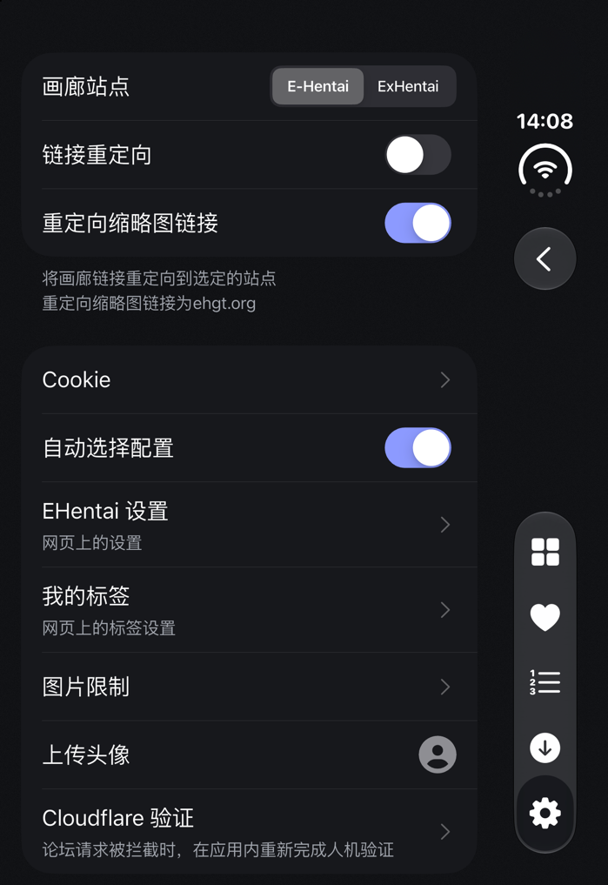
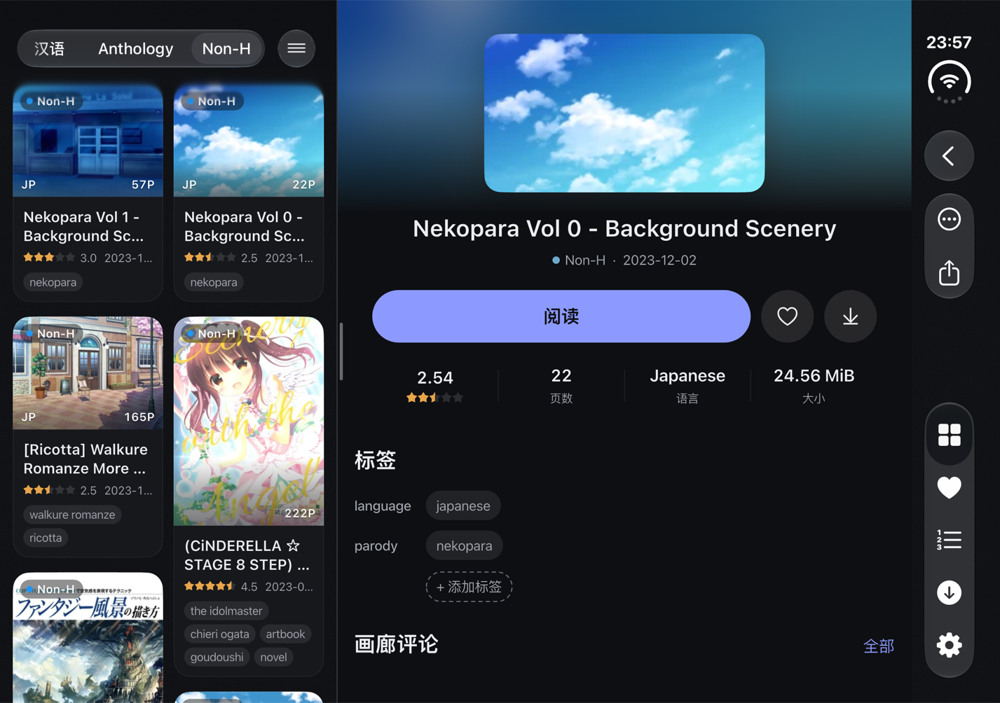
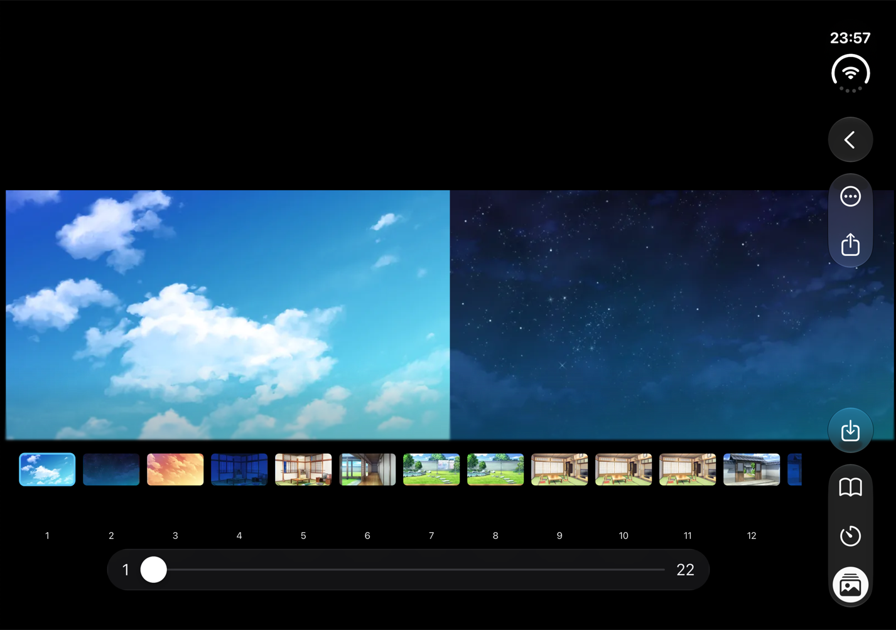
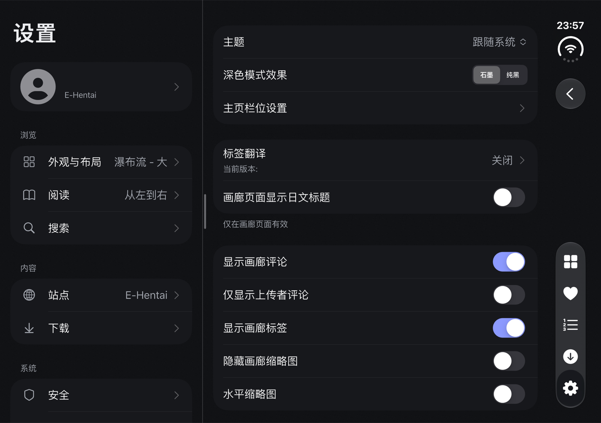

# Eros-FE
[English](./README.md) | 简体中文

一个使用 Flutter 编写的非官方 E-Hentai 客户端。本仓库是 [erosTeam/eros_fe](https://github.com/erosTeam/eros_fe)
的个人 fork，`custom` 分支专注 iOS／iPadOS 与 iPhone Duo 体验：重做主要界面，接入原生液态玻璃导航，
并修复下载、收藏、分享、历史、头像、触感与 Cloudflare 验证等问题。

版本保持 `1.9.2+566`，iOS Bundle ID 为 `cn.honjow.fehv`。

## 应用截图

以下为 iOS 27.1 模拟器上的 iPhone Duo 截图，深色石墨主题，画廊内容均为 Non-H 分类。

### 合上（外屏）

| 首页（瀑布流大卡） | 搜索 | 画廊详情 |
| :---: | :---: | :---: |
|  |  |  |
| **缩略图** | **阅读** | **设置** |
|  |  |  |
| **站点设置与 Cloudflare 验证** | | |
|  | | |

### 展开（内屏）

展开后自动改为双栏：左栏是列表或设置首页，右栏显示画廊详情或设置子页；阅读器按可用宽度并排显示两页。原生竖向栏位于右侧。

| 首页与画廊详情（双栏） |
| :---: |
|  |
| **双页阅读与缩略图条** |
|  |
| **设置（双栏）** |
|  |

## 相比上游的增强

**界面重构**
- 统一配色：浅色、石墨、纯黑三种底色，增强对比度变体，可选强调色开关；石墨背景带细颗粒质感。
- 瀑布流（大）卡片：连续圆角、分类胶囊、评分与日期同行，标签最多 3–4 行，关注标签排在最前并显示 My Tags 颜色。
- 卡片大小：每种列表样式 5 档，列数按实际栏宽计算，设置页直接预览竖屏与横屏列数。
- 画廊详情：模糊封面氛围背景、等面积封面、解析后的标题与「社团 · 作者」、标签与评论分组；宽屏和展开的 iPhone Duo 改为两栏。
- 设置：分组首页（浏览／内容／系统）、原生下拉菜单、统一的子页面外壳。

**iPhone Duo 与原生导航**
- 接入 iOS 27.1 保留区域与铰链几何，按可用空间选择单栏或双栏，详情页可按折痕分栏。
- iOS 27.1+ 使用原生壳（原生顶栏、竖向栏、标签栏），iOS 26–27.0 使用玻璃回退栏；转场、详情闪烁和子页面顶栏已逐页核对。
- 阅读器优化单双页、连续阅读、缩略图条、系统栏与安全区。

**功能修复与增强**
- Cloudflare 验证：切换 E-Hentai／ExHentai 不再请求论坛；论坛被拦截时引导到应用内验证，设置 › 站点新增「Cloudflare 验证」；报错不再弹出整页 HTML。
- 收藏：改用 URL 编码表单避免 HTTP 403，保存与删除都以服务端回读结果为准。
- 下载：暂停、继续或移回下载目录后重新检查，先认领已有文件再补下缺失图片。
- 图片保存：保存当前图片／原图，优先复用缓存，iOS 通过 PhotoKit 保留格式、透明度与动画。
- 分享、历史、可见分组索引、头像上传、操作语义标签等模块的稳定性修复。
- 触感：标签切换、原生栏按钮、菜单与返回补齐震动，选择类轻点走预热的原生通道。

## 更新记录

### 2026-11-01：Cloudflare 验证与 UI 打磨（包 79–93）

关联 tag：`2026-11-01-cf-verification`、`2026-11-01-custom-ui-refresh`。

- **Cloudflare 验证**：论坛（forums.e-hentai.org）受 Cloudflare 保护，旧版切换站点时会顺带请求论坛，被拦截后把整页「Just a moment...」HTML 当作报错弹出。现在切换站点只设置站点、取 igneous、选择配置，不再请求论坛。论坛请求被拦截时识别为 Cloudflare 拦截，弹窗询问是否在内置浏览器中验证，验证后自动重试一次。设置 › 站点新增「Cloudflare 验证」入口。网络报错只显示正文长度，不再输出整页 HTML。同时修复内置验证页一直空白的问题，头像上传里的验证也恢复可用。
- **瀑布流（大）标签**：标签由 2 行增加到 3 行，窄卡 4 行；关注标签排在最前，不会被「+N」折叠。
- **触感**：标签切换使用玻璃质感的清脆触感；原生栏按钮、竖向栏按钮、菜单打开与返回补齐轻触感；selection 改走应用自己的原生通道。
- **卡片大小**：「自定义宽度」改为每种列表样式 5 档，列数按实际栏宽计算。
- **原生壳打磨**：再次点当前标签先退回根页面；单栏详情转场主栏保持可见；详情背景与封面同图，消除切换画廊时的闪烁；对话框打开时原生栏保持标题；所有推入页统一向原生壳提供顶栏配置，并加源码守卫测试。
- **石墨颗粒**：修复背景颗粒的方格接缝。
- 验证：Flutter 全量 841 项通过，`flutter analyze lib test` 0 error。本机最高 runtime iOS 27.1（24A94425）／iPhone Duo 模拟器验证站点来回切换无弹窗、Cloudflare 验证页正常加载并提示「验证完成」。无签名 IPA（包 93）已发布到本 fork 的 [Releases](https://github.com/boitar/eros_fe/releases/latest)。真机效果仍待确认。

### 2026-10-30：修复真机启动黑屏

关联 tag：`2026-10-29-ui-refresh-blackscreen-fix`。

- 画布底色只设置给应用自有窗口（有 rootViewController 且 windowLevel 为 normal），系统文本与键盘窗口保持透明，修复真机启动后整屏黑色的问题。

### 2026-10-29：UI 重构（P1–P5）

关联 tag：`2026-10-29-ui-refresh-p1-palette` 至 `2026-10-29-ui-refresh-p5-unification`。

- **P1 配色管线**：新增语义色 token（canvas、surface、field、hairline、text1–3 等），覆盖浅色、深色、增强对比度与 elevated 共 8 个变体；恢复「深色模式效果」（石墨／纯黑）；原生侧同步窗口与标签栏宿主底色。
- **P2 瀑布流（大）**：重写卡片外观、封面比例与解码、信息区和两行标签；按列表实际宽度自适应列数，展开的 iPhone Duo 列表跨过折痕。
- **P3 画廊详情**：重做首屏（氛围背景、等面积封面、标题解析与标题面板）、原生栏「分享 +…」菜单、标签、评论与缩略图；宽度 ≥ 700pt 或展开的 iPhone Duo 改为两栏。
- **P4 设置页**：分组首页、个人资料行、原生下拉菜单、统一分组列表样式与子页面外壳。
- **P5 统一质感**：开关跟随强调色；iOS 26–27.0 玻璃回退栏；行内说明移到分组页脚；沉浸大卡与画布颗粒。

### 2026-10-28：iPhone Duo 自适应与阅读器更新

关联 tag：`2026-10-28-iphone-duo-adaptive`、`2026-10-28-custom-iphone-duo`。

- 增加 iOS 27.1 保留区域与铰链几何桥接，按可用空间选择自适应布局，保留旧系统回退。
- 各标签维护独立的导航、画廊与搜索状态；更新原生顶栏、分段分类栏、滚动渐隐与多语言文案。
- 阅读器优化单双页、连续阅读、缩略图、系统栏与安全区，修复重进时的控制器生命周期与图片请求锁。

### 2026-10-26：收藏表单兼容与保存确认

关联 tag：`2026-10-26-favorite-form-fix`、`2026-10-26-custom-favorite-form-fix`。

- 收藏提交改用 URL 编码表单，避开 multipart 文本表单触发的 HTTP 403；归档下载、My Tags、站点设置与评论同步修正。
- 保存需服务端回读确认分类与备注，删除需确认已取消收藏；每次操作只发送一次 POST，不确定时有限回读。
- Flutter 全量 554 项通过；iPhone 18 Pro、iPad Pro 11-inch (M5) 与 iPhone Duo 共 12 项原生用例通过。

### 2026-10-18：画廊图片保存到相册

关联 tag：`2026-10-18-gallery-save-cache`、`2026-10-18-custom-gallery-save-cache`。

- 菜单统一为「保存当前图片／保存原图」，当前图片优先复用缓存，原图只复用已确认的原版文件。
- iOS 通过 PhotoKit 以仅添加权限导入，保留格式、透明度和动画；区分权限、下载、格式与写入错误。
- 全量 511 项测试通过；相册中的 PNG、JPEG、GIF 与源文件 SHA-256 一致。

### 2026-10-16：十一个模块整合进 custom

`custom` 从固定 master `2fe86b737` 起步，按序合入 11 个可独立交付的模块，每个模块分支只含一个直接基于 master 的完整提交：

| 模块 | 使用方式 | 独立分支 |
| --- | --- | --- |
| 瀑布流稳定性 | 设置 › 布局 › 瀑布流／瀑布流大卡片 | `codex/custom-waterfall` |
| 下载 | 暂停、继续或移回目录后重新检查已有文件 | `codex/custom-downloads` |
| 收藏 | 传统／玻璃表单、服务端确认、账号隔离 | `codex/custom-favorites-verified` |
| 分享 | iOS／iPadOS 链接、图片、文件与导出 | `codex/custom-sharing` |
| 历史 | 共享初始化、串行写入与等待同步 | `codex/custom-history` |
| 可见分组索引 | 可见 UUID／页面对应与重启恢复 | `codex/custom-group-index` |
| 操作语义 | 传统控件的操作标签 | `codex/custom-accessibility` |
| 触感 | 原生桥接、渐进下拉与操作反馈 | `codex/custom-haptics` |
| 头像 | 相册／文件／URL、验证重试与本机预览 | `codex/custom-avatar` |
| 网格标签 | 等高卡片、两行横滑标签 | `codex/custom-grid-tags` |
| 液态玻璃 | 设置 › 样式：原生导航、顶栏、弹窗与安全区 | `codex/custom-liquid-glass-verified` |

整合树通过全量 486 项测试，iPhone 18 Pro 与 iPad Pro 11-inch (M5) 通过 42 项原生用例。网格标签的当前独立 tag 为 `2026-10-15-custom-grid-tags-independent-verifier`。

## 构建与验证

工具链为 Flutter 3.47.1（最低 3.47.0）与 Xcode 27。首次检出后先准备本机配置，再执行：

```sh
cp lib/config/config.dart.sample lib/config/config.dart
analysis_before="$(mktemp)"
cp analysis_options.yaml "$analysis_before"
flutter pub get --enforce-lockfile
cp "$analysis_before" analysis_options.yaml
dart analyze --format=machine
flutter test --no-pub
```

模拟器构建使用 `Debug-SimulatorUI` 配置（不含 MLKit 与旧归档下载插件注册）。原生验收脚本位于 `benchmark/*_ui_tests/run-native.sh`，参数依次为设备 UUID、仓库外的输出目录和唯一运行名，例如：

```sh
bash benchmark/favorites_ui_tests/run-native.sh \
  "$DEVICE_UUID" "$OUTPUT_DIRECTORY" favorites
```

玻璃组合验收在收藏、头像、分组索引、触感或下载脚本前加 `EROS_VERIFY_GLASS=1`。

**尚未验收**：真机 VoiceOver 与震动强度、Android 实机、OCR、旧归档下载、LiveContainer，以及真实网络下的 Cloudflare 拦截与论坛上传。模拟器结果不能替代这些验收。

## iOS 安装

本 fork 的无签名 IPA 发布在 [Releases](https://github.com/boitar/eros_fe/releases/latest)：arm64，主应用无签名，Bundle ID `cn.honjow.fehv`，最低 iOS 15.6。

1. 从 [Releases](https://github.com/boitar/eros_fe/releases/latest) 下载最新的 `Eros-FE_*-unsigned_*.ipa`。
2. 使用 [AltStore](https://altstore.io) 等工具自行签名后安装。与已装应用同一 Bundle ID 时会覆盖，切换前请先备份应用数据。

上游构建见 [erosTeam/eros_fe Releases](https://github.com/erosTeam/eros_fe/releases/latest) 或 [AltStore.json](https://config-feh.vercel.app/AltStore.json)，不包含本 fork 的增强。

## 功能

- [x] 热门、关注、主页、收藏
- [x] 自定义分组，组合多种条件，分组独立样式
- [x] 列表、瀑布流、网格等视图切换
- [x] 浅色／深色模式
- [x] 画廊信息查看与图片浏览，自动翻页
- [x] 里站表站切换
- [x] 搜索、高级搜索、以图搜图
- [x] 标签翻译，自动匹配标签搜索
- [x] 用户登录，生物认证锁定
- [x] 发表评论，评论赞踩与翻译，论坛头像与快速回复
- [x] EH 设置与 My Tags 同步，长按标签快速设置
- [x] 下载、原图下载、归档下载，直接阅读已下载内容
- [x] WebDAV 同步历史、快速搜索、阅读进度与分组配置
- [x] 屏蔽二维码图片，按 pHash 屏蔽相似广告图

## 翻译

欢迎提交翻译，文案位于 `lib/l10n/{lang}.arb`。

## 感谢

UI 主要参考 [E-HentaiViewer](https://github.com/kayanouriko/E-HentaiViewer)，并借鉴以下项目的部分代码与逻辑：

- [E-HentaiViewer](https://github.com/kayanouriko/E-HentaiViewer)
- [EhViewer](https://github.com/seven332/EhViewer)
- [EhTagTranslation/Database](https://github.com/EhTagTranslation/Database)（标签译文数据库）

翻译贡献：

- [KeepSOBP](https://github.com/KeepSOBP)：韩语
- [pursel](https://github.com/pursel)、[Gigas002](https://github.com/Gigas002)：俄语
- [cristal-node](https://github.com/cristal-node)：日语

## 依赖项目（部分）

- 网络：[dio](https://pub.dev/packages/dio)
- 状态管理：[getx](https://pub.dev/packages/get)
- 数据库：[sqflite](https://pub.dev/packages/sqflite)
- 持久化：[shared_preferences](https://pub.dev/packages/shared_preferences)
- 国际化：[intl](https://pub.dev/packages/intl)
- 图片：[cached_network_image](https://pub.dev/packages/cached_network_image)、[extended_image](https://pub.dev/packages/extended_image)
